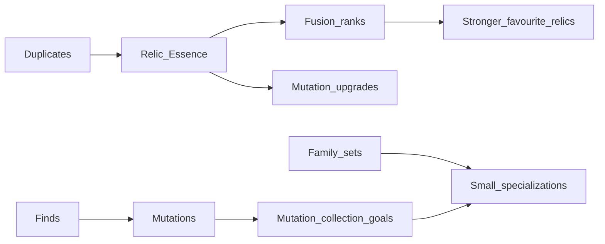

# Phase 2 — Collection layer (Essence, fusion, mutations, unlocks)

**Goal:** Keep the game entertaining while rarity is slower — not just stretch time-to-Legendary.  
**Prerequisite:** Provisional balance `E20k_L12_C17_HR` accepted after Astra review of `docs/PROVISIONAL_E20k_RESULTS.md`.  
**Non-goal:** Do not implement Update-1 zones / advanced fusion / full BGH in this phase.

---

## Design principles

1. **Something meaningful every 5–10 minutes** of active play (unlock, fuse rank, set step, mutation goal) even if the next Epic is far.
2. **CE and Essence are not interchangeable** — Luck cannot buy out the collection path.
3. **Data-driven recipes/milestones** so Update 1–3 can add content without rewriting RollService.
4. **Launch-complete core:** fusion + Essence + mutation goals ship as a fun loop; advanced branches wait.

---

## Systems to ship in Phase 2

### 1. Relic Essence (second currency)

| | |
|--|--|
| **Earn** | Dismantle / auto-sell path converts surplus duplicates to Essence (tier-scaled). Hunting grants a small Essence bonus per capture. Offerings/bounties can grant Essence instead of raw roll spam. |
| **Spend** | Fusion ranks, mutation resonance crafts, targeted “Attune” pulls (see soft-lock fix). |
| **Rule** | No CE→Essence convert (or only a punitive sink if absolutely needed for support). |

**Save:** `data.Essence: number` + migration.  
**UI:** HUD chip + Inventory dismantle / bulk convert.

### 2. Basic fusion (cap 3) + Charm specialization

| | |
|--|--|
| **Board** | Start **1** concurrent fused relic; milestones / Rebirth open slots (max 5) |
| **Recipe** | Same relic id (**v1: base only**): **3 / 5 / 4** copies for ranks 1–3; rank 3 also needs a mutated copy. Modest Essence by tier — scarcity from slots + targeted dups, not cost inflation |
| **Epic** | Craft **Epic Catalyst** (3 Epic dups + Essence) before first Epic fuse |
| **Effect** | Modest income mult per rank — never the main reward |
| **Charm (rank 1)** | Pick **Hunt** / **Workshop** / **Shrine**. Respec later for Essence. Not Frequency Focus / Spirit Sight duplicates. |
| **Hard rule** | Fusion never changes rarity tier |
| **Cap** | 3 ranks at launch; schema allows higher later |

**Data:** `CollectionConfig.luau` (+ `CollectionMath`).  
**Extends:** Update 2 adds ranks 4–5 and Charm rows / region branches.

### 3. Mutation collection goals (unlocks, not only +luck)

Keep discovery mutations as-is; staged **goals** unlock mechanics past R1 (Attune, Targeted Attune, Epic salvage/catalyst, Charm respec, Family Attune, Mutation Focus, board slots). Prefer few goals that each open a useful objective — not busywork task lists.

**Codex:** `MutationGoals` with **mechanic unlocks** (flags), not only potions/luck.  
Stat bonuses allowed as garnish, never the only reward.

### 4. Family set progress

| | |
|--|--|
| **Track** | Unique Common→Legendary per Family |
| **Rewards** | At 50%: Frequency unlock stays; **plus** small specialization (e.g. +Essence on captures in themed zone — table-driven) |
| **100%** | Existing Archivist title + a real perk (e.g. one free daily Attune) |

### 5. High-luck collection access (must pair with Phase 1)

If MaxLuck soft-locks Commons (confirmed in provisional sim):

- Soft prompt when Essential missing and low-tier mass ≈ 0: switch Focus
- **Attune ticket** (Essence sink): next N scans forced to Focus Common/Uncommon
- Do not rely on wiki knowledge

---

## Suggested Phase 2 implementation order

1. Essence earn on duplicate sell + currency UI  
2. Fusion cap-3 + Charm choice  
3. Resonance on Rebirth (Collector / Binder / Seeker + stack unlocks)  
4. Focus/Attune soft-lock fix (if not already in Phase 1)  
5. Mutation goals (3–5 launch goals)

**Studio prototype status:** see [`docs/STUDIO_PROTOTYPE.md`](STUDIO_PROTOTYPE.md) (behind `BalanceTrials` flags). A+C balance still sim-only.

Stop before: zone-exclusive relics, Hunt Essence renaming debates, merge trees, pedestal synergies (Update hooks only).

---

## Future update hooks (do not build now)

| Update | Hook already satisfied if Phase 2 ships |
|--------|----------------------------------------|
| Update 1 new region | Family/zone perk table rows; Essence from new activities |
| Update 2 advanced fusion | Raise cap / add `FusionConfig.Branches` |
| Update 3 endgame | Mutation goals at Celestial/Cosmic; Rebirth talent spend |

---

## Success criteria (playtest)

- After ~30–60 min on provisional balance, player can point to **fusion or Essence spend** they care about besides Core Luck.
- Duplicate Commons feel useful.
- A mutated find is exciting because it **progresses a goal**, not only CE/sec.
- Missing Codex Commons remains solvable at high luck without feeling broken.
